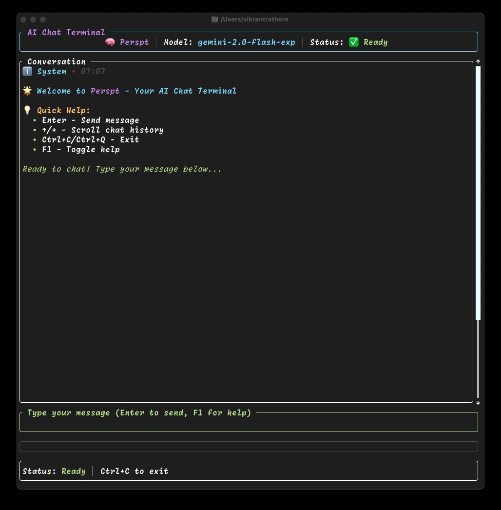

<div align="center">


# Perspt

**AI chat and coding in the terminal.**

[](https://github.com/eonseed/perspt/actions/workflows/ci.yml)
[](https://eonseed.github.io/perspt/)
[-059669)](https://github.com/eonseed/perspt/releases)
[](LICENSE)

[**Website & Docs**](https://eonseed.github.io/perspt/) · [**The Perspt Book**](https://eonseed.github.io/perspt/book/index.html) · [**PDF Handbook**](https://eonseed.github.io/perspt/books/perspt-book-en.pdf) · [**Rust SDK Docs**](https://eonseed.github.io/perspt/perspt/index.html) · [**PSP Archive**](https://eonseed.github.io/perspt/psps/index.html)

[](https://github.com/user-attachments/assets/f80f7109-1615-487b-b2a8-b76e16ebf6a7)

</div>

---

**Perspt** is an AI chat and coding assistant that runs in the terminal. Ask questions, discuss code, or give the coding agent a bug to fix. It works with cloud providers and local models through Ollama.

| Task | Command or library | What it does |
|---|---|---|
| **Chat with AI** | `perspt chat` | A full-screen conversation with streamed answers, Markdown, and code |
| **Use simple terminal chat** | `perspt simple-chat` | Read and write messages one line at a time, with optional conversation logging |
| **Work on a codebase** | `perspt agent` | Edit a project copy, run builds and tests, and review changes before applying them |
| **Use Perspt in a Rust app** | `perspt-sdk` and related crates | Add AI workflows, build and test checks, and session history |

**The coding agent works on a separate copy of the project.** It reads files, makes edits, and uses build errors and test failures to guide corrections. When the required checks pass, it asks for review before copying changes into the project. If it cannot finish within its attempt limits, it stops and reports the remaining problems.

Agent mode is experimental. Review the diff and tests before committing: a passing test suite can miss bugs. Applying edits does not create a Git commit.

## Quick Start

Build Perspt from source (requires Rust 1.97.1+):

```bash
git clone https://github.com/eonseed/perspt.git
cd perspt
cargo install --locked --path crates/perspt-cli --features bundled

export GEMINI_API_KEY="your-api-key"   # Or OPENAI_API_KEY, ANTHROPIC_API_KEY, or local Ollama
```

The CLI is now on the Cargo binary path. Try the three modes:

```bash
# 1. Plain terminal chat with session logging
perspt simple-chat --log-file chat.txt

# 2. Full-screen chat
perspt chat

# 3. A small coding task in an existing project
perspt agent -w ./my-project "Fix the failing parser tests"

# Headless agent run + live browser dashboard on http://127.0.0.1:3000
perspt agent --yes --dashboard -w ./my-project "Add input validation and unit tests"
```

`simple-chat` takes no positional prompt. Piped input sends one message per non-empty line. Its stdout includes session messages as well as responses.

> **Note on Windows**: `chat` and `simple-chat` work natively on Linux, macOS, and Windows. `perspt agent` uses Bubblewrap on Linux and `sandbox-exec` on macOS for OS process isolation; on native Windows, pass `--allow-unisolated` or run inside WSL2.

## Embed with the Perspt SDK

You can integrate Perspt's verification engine and domain packages directly into your own Rust applications:

```toml
[dependencies]
perspt-sdk = { git = "https://github.com/eonseed/perspt" }
perspt-coding = { git = "https://github.com/eonseed/perspt" }
```

```rust
use perspt_coding::CodingDomain;
use perspt_sdk::{
    domain::{AgentDomainPackage, DomainScope},
    energy::score_candidate,
    gate::{evaluate_gate, GateDecision},
    residual::ResidualEvent,
};

fn check_candidate(
    scope: &DomainScope,
    residuals: &[ResidualEvent],
    all_required_checks_passed: bool,
    best_v: f64,
) -> perspt_sdk::error::Result<GateDecision> {
    let model = CodingDomain.energy_model(scope);
    let score = score_candidate(&model, residuals)?;
    let hard_pass = all_required_checks_passed
        && score.hard_violations.is_empty()
        && score.blocked.is_empty();
    evaluate_gate(hard_pass, score.total, best_v, model.rho_gate)
}

```

The caller supplies the measured required-check result. An empty threshold-violation list alone does not establish a hard pass. A descent decision is intermediate progress, not delivery.

## Supported LLM Providers

Set a provider credential or configure a portfolio in `config.toml`. Model IDs below are examples, not a catalog of currently available models. Availability depends on the provider account:

| Provider | Environment Variable / Auth | Example Model ID |
|---|---|---|
| **Google Gemini** | `GEMINI_API_KEY` | `gemini::gemini-3.5-flash` |
| **OpenAI / Compatible** | `OPENAI_API_KEY` (`OPENAI_BASE_URL`) | `openai::gpt-4o` |
| **Anthropic** | `ANTHROPIC_API_KEY` | `anthropic::claude-3-5-sonnet-20241022` |
| **Google Vertex AI** | Google Cloud ADC (`gcloud auth`) | `vertex::gemini-3.5-flash-lite` |
| **Ollama (Local)** | None (local server) | `ollama::qwen2.5-coder` |
| **Groq** | `GROQ_API_KEY` | `groq::llama-3.1-8b-instant` |
| **DeepSeek** | `DEEPSEEK_API_KEY` | `deepseek::deepseek-chat` |
| **xAI** | `XAI_API_KEY` | `xai::grok-beta` |
| **Cohere** | `COHERE_API_KEY` | `cohere::command-r-plus` |

## CLI Commands

| Command | Description |
|---|---|
| `perspt chat` | Interactive full-screen Terminal UI chat (default when running `perspt`) |
| `perspt simple-chat` | Line-oriented terminal chat with optional session logging |
| `perspt agent <TASK>` | Autonomous SRBN coding agent with compiler, LSP, and test verification |
| `perspt dashboard` | Real-time web dashboard for monitoring sessions, diffs, and energy |
| `perspt status` | Show active session progress and verification status |
| `perspt ledger` | Inspect session history or undo the newest promotion (`--rollback <ID>`) |
| `perspt resume <ID>` | Resume an interrupted agent session from the DuckDB ledger |
| `perspt replay <ID>` | Audit recorded session events offline without model calls or rerunning tests |
| `perspt providers` | Show configured providers (`--probe` tests live connectivity) |
| `perspt config` | View (`--show`) or edit (`--edit`) configuration |
| `perspt init` | Initialize project memory and Starlark security policy rules |

Run `perspt <COMMAND> --help` for full options.

## Workspace Crates

| Crate | Role |
|---|---|
| `perspt-sdk` | Domain-neutral SRBN control plane: residuals, energy, gates, capabilities, replay |
| `perspt-coding` | Coding domain package: Rust/Python/TypeScript verifiers, diagnostics, and adapters |
| `perspt-research` | Research domain package built on `perspt-sdk` |
| `perspt-agent` | Governed candidate runtime, tool loop, LSP client, and work-graph scheduler |
| `perspt-core` | Shared configuration, provider portfolio, events, and prompt libraries |
| `perspt-tui` | Ratatui terminal UI for interactive chat and agent review |
| `perspt-cli` | Command-line binary entry point (`perspt`) |
| `perspt-store` | DuckDB session ledger, content-addressed artifacts, and calibration store |
| `perspt-policy` | Starlark security policy engine and command guards |
| `perspt-sandbox` | OS process isolation (Bubblewrap / `sandbox-exec`) |
| `perspt-dashboard` | Axum + HTMX real-time web observability dashboard |
| `perspt-prompt-macros` | Compile-time code generator for typed prompt section libraries |
| `perspt-benchmark` | Optional manual evaluation suite (`--features benchmark`) |
| `perspt` | Top-level meta-crate |

## Building & Testing

```bash
# Format, lint, test, and check code rules
cargo fmt --all -- --check
cargo clippy --locked --workspace --all-targets -- -D warnings
cargo test --locked --workspace --all-targets -- --test-threads=1
./check-rules.sh check

# Build unified documentation site & PDF book (requires guidedog and typst)
./generate-docs.sh
```

## Documentation & License

- **Unified Documentation Site**: [https://eonseed.github.io/perspt/](https://eonseed.github.io/perspt/)
- **The Perspt Book (HTML & PDF)**: [Book Online](https://eonseed.github.io/perspt/book/index.html) · [Book PDF](https://eonseed.github.io/perspt/books/perspt-book-en.pdf)
- **Specification Proposals (PSPs)**: [PSP Catalog](https://eonseed.github.io/perspt/psps/index.html)
- **Contributing**: See [CONTRIBUTING](docs/perspt_book/developer-guide/contributing.rst)
- **License**: Perspt is licensed under the [GNU Lesser General Public License v3.0 (LGPL-3.0)](LICENSE).
