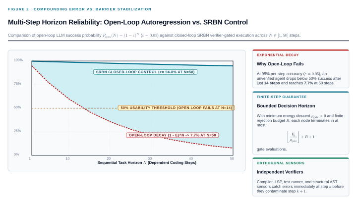

Introduction to Perspt
======================

**Perspt brings model conversations and checked coding tasks into the terminal.** We can use a cloud provider or a local model and choose an interface that fits the task.

Choose a mode
-------------

.. list-table::
   :header-rows: 1
   :widths: 25 30 45

   * - Goal
     - Command or library
     - What happens
   * - **Talk through a problem**
     - ``perspt chat`` or ``perspt``
     - Full-screen chat with streaming Markdown, code, multiline input, and configured read-only MCP operations.
   * - **Use plain terminal chat**
     - ``perspt simple-chat``
     - A line-oriented conversation with optional session logging. Piped input is one message per non-empty line; stdout includes session messages.
   * - **Change a codebase**
     - ``perspt agent -w ./app "Fix the parser tests"``
     - Experimental coding agent with candidate copies, project checks, repair attempts, and promotion review.
   * - **Build a custom workflow**
     - ``perspt-sdk`` and domain crates
     - Rust libraries for residual scoring, acceptance gates, capabilities, and recorded decisions.

For a first run, follow :doc:`quickstart`.
For plain chat controls, see :doc:`user-guide/basic-usage`.
For configured providers and explicit model routes, see :doc:`user-guide/providers`.

What the coding agent does
--------------------------

We describe the change and the project directory:

.. code-block:: bash

   perspt agent -w ./app "Add CSV export with tests for empty input"

Perspt explores the repository and applies proposed edits to a candidate copy.
The default run uses one work node; optional parallel dispatch can decompose a larger task.
Detected language plugins provide checks for Rust, Python, and JavaScript/TypeScript projects.

.. figure:: ../shared/_static/agent-workflow-overview.svg
   :target: _static/agent-workflow-overview.svg
   :alt: A task becomes candidate edits, project checks, and an approved promotion, with a bounded correction loop.
   :width: 100%

   Proposed edits stay in the candidate workspace. A delivered result must pass the required checks and receive promotion approval.

**Verification guides the next attempt.** Compiler diagnostics, failing tests, and other residuals become a non-negative error score called energy, written :math:`V`.
The agent can keep a checkpoint that reduces the best accepted score by the configured margin.
A hard pass means the required checks passed; it is the success condition for delivery.
Attempts that fail the gate do not advance accepted progress.
Turn and rejection limits can end a run with errors remaining.

   Verification supplies evidence within the coverage of the configured checks. This diagram makes no benchmark or success-rate claim.

**A pass is evidence, not proof of every requirement.** By default the tests can change with the implementation.
We can select historical regression checks or separately maintained acceptance tests when the task needs stronger evidence.
See :doc:`configuration` for these policies.

The runtime calls this propose, measure, and correct process **SRBN (Stabilized Recursive Barrier Networks)**.
The practical workflow requires no mathematics.
:doc:`concepts/srbn-architecture` explains the gate, energy function, and relation to the stability papers.

Review, inspect, and recover
----------------------------

- **Review before promotion.** Inspect the diff and verification results in the terminal. ``--yes`` approves promotion automatically for unattended runs.
- **Watch a live run.** Add ``--dashboard`` and open ``http://127.0.0.1:3000`` while the agent runs.
- **Inspect recorded decisions.** ``perspt replay <session-id>`` audits the ledger without model calls or rerunning the verifier tools.
- **Continue interrupted work.** ``perspt resume --last`` rebuilds the recorded state and checks authority before continuing.
- **Undo the latest promotion in a session.** ``perspt ledger --rollback <session-prefix>`` restores recorded pre-images unless the promoted files have since changed.

Promotion copies files into the project; it does not create a Git commit.
Candidate copies and OS process isolation serve different purposes.
Linux uses Bubblewrap and macOS uses ``sandbox-exec`` for process isolation.
Native Windows agent execution requires explicit reduced isolation or WSL.
See :doc:`installation` for prerequisites and :doc:`user-guide/agent-mode` for the full workflow.

Reuse the Rust libraries
------------------------

The workspace contains fourteen product crates and a development-only ``xtask`` crate.
``perspt-sdk`` defines shared contracts; ``perspt-coding`` supplies coding residuals and adapters; ``perspt-agent`` runs governed sessions.
``perspt-research`` is a second-domain skeleton rather than a complete research assistant.

:doc:`api/index` contains an SDK example and a crate map.
:doc:`reference/cli-reference` lists the commands and options.
