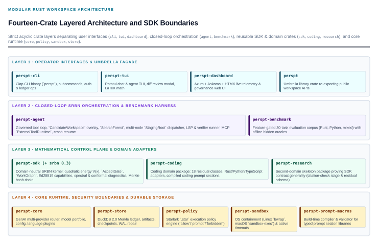

.. meta::
   :description: Perspt is a high-performance Rust AI agent and terminal workspace built on Stabilized Recursive Barrier Networks (SRBN), governed tool loops, and Merkle-backed DuckDB provenance.

Perspt
======

.. container:: hero

   .. container:: hero-copy

      .. rst-class:: eyebrow

      STABILIZED RECURSIVE BARRIER NETWORKS

      .. raw:: html

         <h1>Generative velocity. <em>Deterministic stability.</em></h1>

      .. rst-class:: lead

      A high-performance Rust AI agent and terminal platform where every stochastic action is a proposal, every effect is capability-mediated, and only energy-descending states enter the Merkle-backed trajectory.

      .. container:: actions

         `Read the Book <mount://book/index.html>`_
         `Explore PSPs <mount://psps/index.html>`_
         `Download PDF <mount://pdf/perspt-book-en.pdf>`_

      .. rst-class:: hero-note

      100% Rust workspace. Zero Python runtime dependencies. TUI, Headless CLI, and Real-Time Web Dashboard.

      Linux, macOS, and Windows. `Source on GitHub <https://github.com/eonseed/perspt>`_ · `Rust API Docs <perspt/index.html>`_.

   .. container:: hero-art

      .. image:: ../shared/_static/cover-art.svg
         :alt: Speculative search trajectories converging across quadratic Lyapunov energy contours into the safe manifold.

      .. rst-class:: art-caption

      PROPOSE / VERIFY / RATCHET

.. container:: pillars

   .. container:: pillar

      .. rubric:: 01 / Quadratic Lyapunov Energy

      Measure every candidate state.
      Compiler diagnostics, LSP symbols, structural contracts, weighted test suites, and sheaf validators map into finite non-negative residuals :math:`V(x) = \sum_{e \in E} w_e \|r_e(x)\|^2`.

   .. container:: pillar

      .. rubric:: 02 / Capability-Mediated Tool Loop

      Confinement outside the model.
      Every file edit, shell command, and MCP tool invocation passes an admissibility kernel with Starlark policy evaluation, OS sandboxing, and capability attenuation.

   .. container:: pillar

      .. rubric:: 03 / Merkle-Backed Replay & Audit

      Append-only DuckDB provenance.
      Accepted states ratchet forward on hard pass or measured descent :math:`V(y) \le V_{\mathrm{best}} - \rho_{\mathrm{gate}}`, while speculative branches flush cleanly without polluting history.

.. container:: section-heading

   .. rst-class:: eyebrow

   WHY STABILITY MATTERS

   .. rubric:: Breaking the exponential decay of unpaginated agentic loops.

Standard unverified LLM chains compound per-step drift exponentially: even a 95% per-step success rate collapses below 8% over 50 steps. Perspt's SRBN control barrier measures candidate realizations against deterministic language toolchains and ratchets only verified states onto the accepted trajectory.

.. figure:: ../shared/_static/front-page-abm.svg
   :alt: Agent-based simulation comparing unguided LLM drift against SRBN Lyapunov-guided trajectory convergence.
   :width: 100%

   Multi-step trajectory convergence: unguided generative chains diverge into the high-energy failure zone while SRBN barrier guidance contracts trajectories into the zero-energy safe manifold.

.. container:: split-section

   .. container:: split-copy

      .. rst-class:: eyebrow

      GOVERNED CONTROL LOOP

      .. rubric:: Every proposal is observed. Only verified descent commits.

      Perspt separates stochastic generation from deterministic authority. The Architect decomposes goals into an acyclic, revisioned ``WorkGraph``; the Actuator proposes candidate edits in isolated workspaces; the Admissibility Kernel checks capabilities and leases; and the Verifier Suite scores residual energy before the Merkle Ledger commits.

      When a branch stalls, bounded speculative search explores alternative strategies and model-conditioned prompt programs without adding accepted gate decisions.

      `Explore the SRBN Architecture <mount://book/concepts/srbn-architecture.html>`_

   .. image:: ../shared/_static/srbn-control-sequence.svg
      :alt: Sequence diagram of the SRBN governed control loop across User, Orchestrator, Architect, Actuator, Admissibility Kernel, Verifier Suite, and Merkle Ledger.

.. container:: section-heading

   .. rst-class:: eyebrow

   MODULAR RUST WORKSPACE

   .. rubric:: Fourteen focused crates. One governed execution contract.

From the domain-neutral ``perspt-sdk`` nucleus and ``perspt-coding`` verifier suite to the ``ratatui`` terminal interface, ``axum`` + ``htmx`` real-time web dashboard, and DuckDB v2.0.0 analytical ledger, every subsystem is engineered in pure Rust with strict file, function, and line complexity bounds.

   The Perspt workspace stack: presentation surfaces (CLI, TUI, Web Dashboard) drive the SRBN orchestrator over the domain-neutral SDK, security & persistence engines, and multi-provider model portfolio.

.. container:: book-section

   .. image:: ../shared/_static/book-cover.png
      :alt: Cover of The Perspt Book: Generative velocity. Deterministic stability.

   .. container:: book-copy

      .. rst-class:: eyebrow

      THE PERSPT BOOK & SPECIFICATION ARCHIVE

      .. rubric:: Theory, architecture, and operational handbook in one place.

      *The Perspt Book* covers everything from quickstart installation and provider configuration to the mathematical foundations of Stabilized Recursive Barrier Networks, Starlark security policies, MCP tool admission, and crate-by-crate API references.

      Alongside the book, the **Perspt Specification Proposals (PSPs)** catalog preserves the complete engineering design history and conformance gates for every major subsystem, compiled to both HTML and standalone Typst PDFs.

      .. container:: actions

         `Start Reading the Book <mount://book/index.html>`_
         `Open the PDF Book <mount://pdf/perspt-book-en.pdf>`_
         `Browse PSP Catalog <mount://psps/index.html>`_

.. container:: text-links

   `Getting Started <mount://book/getting-started.html>`_
   `Agent Mode Guide <mount://book/user-guide/agent-mode.html>`_
   `Real-Time Dashboard <mount://book/user-guide/dashboard.html>`_
   `Starlark Policy Engine <mount://book/howto/security-rules.html>`_
   `MCP Integration <mount://book/user-guide/mcp.html>`_
   `PSP Registry <mount://psps/registry.html>`_
   `Rust API (rustdoc) <perspt/index.html>`_

Build and Run Perspt
--------------------

Install or build Perspt from source using Cargo:

.. code-block:: sh

   git clone https://github.com/eonseed/perspt.git
   cd perspt
   cargo build --release

   # Interactive TUI chat
   ./target/release/perspt

   # Autonomous SRBN coding agent with live web dashboard
   ./target/release/perspt agent --dashboard "Build a CLI calculator in Rust with unit tests"

   # Inspect session ledger and energy history
   ./target/release/perspt status
   ./target/release/perspt ledger
