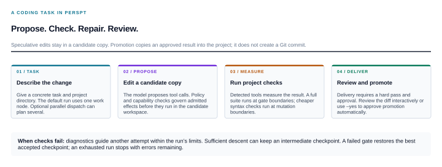
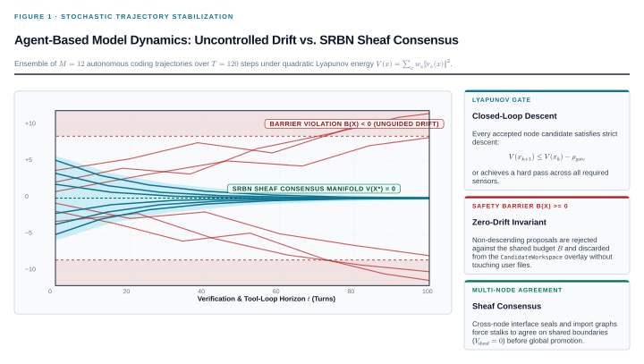

.. meta::
   :description: Chat with AI, explore a codebase, and make checked code changes from the terminal. Perspt combines interactive chat, a coding agent, and reusable Rust libraries.

Perspt
======

.. container:: hero

   .. container:: hero-copy

      .. rst-class:: eyebrow

      PERSPT / AI TOOLS FOR DEVELOPERS

      .. raw:: html

         <h1>From a question to a checked change.</h1>

      .. rst-class:: lead

      Chat with a model. Find our way through a codebase. Ask an agent to change it and run the checks. Perspt brings these workflows into the terminal, with cloud or local models and a reusable Rust SDK.

      .. container:: actions

         `Get started <mount://book/quickstart.html>`_
         `See the agent workflow <mount://book/tutorials/agent-mode.html>`_

      .. rst-class:: hero-note

      One Rust binary. Nine provider adapters. Linux, macOS, and Windows.

      `GitHub <https://github.com/eonseed/perspt>`_ | `Read the book <mount://book/index.html>`_ | `Download PDF <mount://pdf/perspt-book-en.pdf>`_

   .. container:: hero-art

      .. image:: ../shared/_static/cover-art.svg
         :alt: Perspt commands for full-screen chat, plain terminal chat, checked coding tasks, and the Rust SDK.

      .. rst-class:: art-caption

      CHOOSE A COMMAND. START WITH A SMALL TASK.

.. container:: section-heading

   .. rst-class:: eyebrow

   START WITH THE JOB

   .. rubric:: Four ways to put Perspt to work.

.. container:: pillars

   .. container:: pillar

      .. rubric:: Talk through a problem

      **Full-screen chat with streamed answers.** Read Markdown and code, paste multiline input, and inspect configured read-only MCP tools with ``/mcp``.

      .. code-block:: sh

         perspt chat

      `Start a conversation <mount://book/tutorials/first-chat.html>`_

   .. container:: pillar

      .. rubric:: Keep the terminal simple

      **Chat without a full-screen interface.** Use a line editor and save the conversation with ``--log-file``. Piped input sends one message per non-empty line; output includes session messages.

      .. code-block:: sh

         perspt simple-chat --log-file chat.txt

      `Learn the controls <mount://book/user-guide/basic-usage.html>`_

   .. container:: pillar

      .. rubric:: Make a checked code change

      **Give the agent a task and a project directory.** It edits a candidate copy, runs the available project checks, and requests review before promotion. Agent mode is experimental.

      .. code-block:: sh

         perspt agent -w ./app "Fix the parser tests"

      `Try a coding task <mount://book/tutorials/agent-mode.html>`_

   .. container:: pillar

      .. rubric:: Build on the Rust SDK

      **Reuse the scoring, gates, and domain contracts.** Embed the pieces needed for a custom workflow. The coding package provides adapters for Rust, Python, and TypeScript; the research package is a skeleton.

      .. code-block:: sh

         cargo add perspt-sdk perspt-coding \
           --git https://github.com/eonseed/perspt

      `Open the SDK guide <mount://book/api/index.html>`_

.. container:: section-heading

   .. rst-class:: eyebrow

   A CODING TASK, STEP BY STEP

   .. rubric:: Propose. Check. Repair. Review.

**The model proposes changes; the tools measure them.** Perspt keeps speculative edits in a candidate workspace. It checks the result with the detected language toolchain and uses the diagnostics to guide another attempt when needed.

   Promotion copies an approved result into the project. It does not create a Git commit. ``--yes`` approves promotion automatically; verification still runs.

**A lower error score means progress, not completion.** Perspt can keep an improving checkpoint inside the candidate workspace. Delivery requires a hard pass of the required checks and approval. A run can also stop with unresolved errors when its limits are reached.

   An illustration of measured progress, not benchmark data. Dots represent discrete verification results. Curves help us follow the attempts; they do not imply continuous execution or guaranteed convergence.

.. container:: split-section

   .. container:: split-copy

      .. rst-class:: eyebrow

      KEEP THE EVIDENCE CLOSE

      .. rubric:: Inspect the change. Understand the outcome.

      **Watch a live run** with ``perspt agent --dashboard``. The local browser view shows measurements, decisions, and session progress.

      **Inspect the record** with ``perspt replay <session-id>``. Replay audits recorded events without calling a model or rerunning the tests.

      **Undo a promotion** with ``perspt ledger --rollback <session-prefix>``. Rollback targets that session's newest completed promotion and refuses to overwrite files changed since then.

      `Read the agent guide <mount://book/user-guide/agent-mode.html>`_

   .. container:: split-copy

      .. rst-class:: eyebrow

      KNOW WHAT A PASS MEANS

      .. rubric:: Checks provide evidence within their scope.

      A hard pass means the required configured checks passed. Tests can evolve with the implementation by default. Stronger regression and external acceptance policies are available.

      Candidate copies, command policies, and OS process isolation protect different boundaries. Linux uses Bubblewrap; macOS uses ``sandbox-exec``. Native Windows agent runs require explicit reduced isolation or WSL.

      `Choose a test policy <mount://book/configuration.html>`_ | `Check prerequisites <mount://book/installation.html>`_

Get started
-----------

From the repository root, build a self-contained CLI and install it on the Cargo binary path:

.. code-block:: sh

   git clone https://github.com/eonseed/perspt.git
   cd perspt
   cargo install --locked --path crates/perspt-cli --features bundled
   export GEMINI_API_KEY="<api-key>"
   perspt chat

**Prefer local models?** Configure Ollama and select an installed model with an explicit route such as ``ollama::llama3.2``. **Ready for code changes?** Start with a small task in an existing project whose checks already run locally.

.. container:: text-links

   `Quick start <mount://book/quickstart.html>`_
   `Local models <mount://book/tutorials/local-models.html>`_
   `Agent tutorial <mount://book/tutorials/agent-mode.html>`_
   `Rust SDK <mount://book/api/index.html>`_
   `Architecture <mount://book/concepts/srbn-architecture.html>`_
   `Specification proposals <mount://psps/index.html>`_
   `Rustdoc <perspt/index.html>`_
